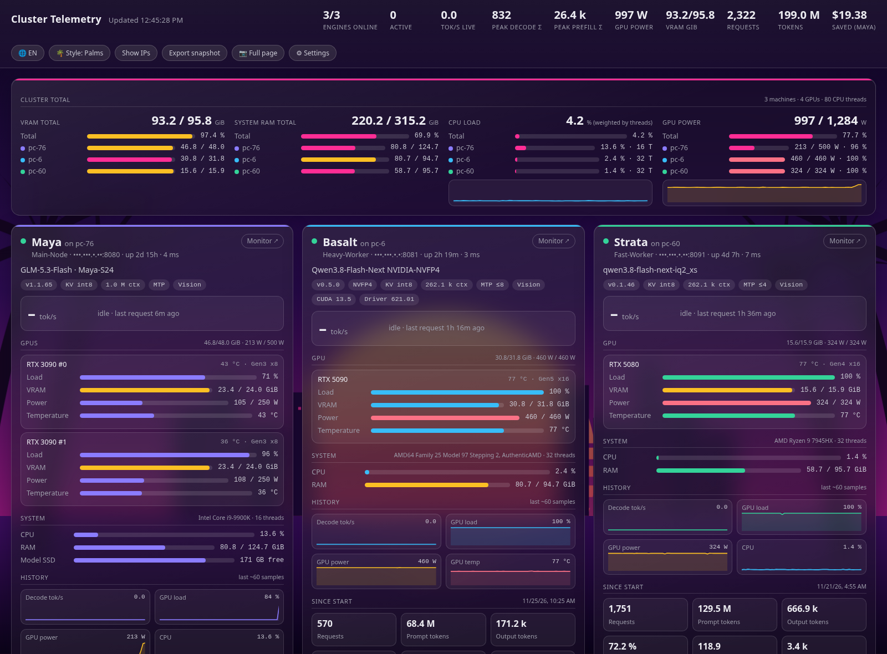
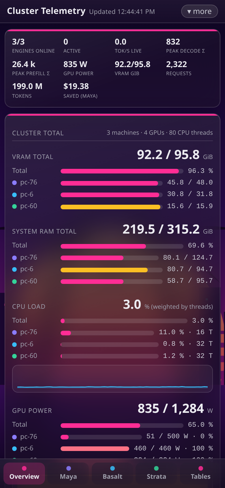

# AIdashy

🇬🇧 English · 🇩🇪 [Deutsch](README.de.md)

A configurable dashboard for multiple different AI models. For the start, Strata, Project Maya and Basalt are included.

Telemetry for several LLM servers on the LAN: load, VRAM, power, throughput, recent requests and
optional GPU-miner control. A single Python process without dependencies (standard library only).

<p align="center">
  
  
</p>

## Setting up a new system

```bash
git clone https://github.com/JDmotions/AIdashy.git ~/tools/cluster-dashboard && cd ~/tools/cluster-dashboard
python3 server.py            # creates config.json from config.default.json, listens on :8095
```

Then open `http://<machine>:8095/config` in a browser and enter:

- **Machines** (IP, name, role) – engines are found automatically by port scan (`scan_ports`)
- **API keys** or key files of the engines
- **Engines** (display name, colour, UI path per service type)
- **Other engines (detection)** – which third-party engines to look for (see below)

Alternatively load an exported configuration via **⇧ Import**.

### As a service (systemd, user)

```bash
cp deploy/*.service ~/.config/systemd/user/
systemctl --user daemon-reload
systemctl --user enable --now cluster-dashboard.service
loginctl enable-linger $USER          # keeps running without a login session
```

### Remote access (optional)

1. Create a login: `python3 server.py --set-password USER`, then restart the service
2. Put `cloudflared` into `bin/` ([releases](https://github.com/cloudflare/cloudflared/releases))
3. `systemctl --user enable --now cluster-dashboard-tunnel.service` – the URL is written to `tunnel.url`
4. Optional e-mail on a new URL: create `tunnel.env` with `MAIL_CMD=sendmail` and `MAIL_PREFIX="…"`

No login is needed on the LAN; via the tunnel it is always required.

## Other engines

Besides its own engines (Maya, Basalt, Strata) the dashboard detects these engines during the
port scan and shows each as its own card (`engines.py`):

| Engine | Detected via | What is shown | Requirement |
|---|---|---|---|
| llama.cpp (`llama-server`) | `/props` | model, context, slots, running/deferred requests, prefill/decode tok/s, token totals | rates and totals only with `--metrics` |
| vLLM | `/metrics` (`vllm:`) | running/waiting, KV cache %, prefix-cache hits, mean TTFT, tok/s, token and request totals | – |
| SGLang | `/get_server_info` | running/queued, KV usage, cache hit rate, tok/s, TTFT | metrics only with `--enable-metrics` |
| Hugging Face TGI | `/info` | batch/queue, tok/s, token totals, mean time per token | – |
| TabbyAPI (ExLlama) | `/.well-known/serviceinfo` | like llama.cpp, plus cached prompt tokens | `/metrics` with `network.enable_metrics: true`; API key in the configuration |
| Ollama | `/api/version` + `/api/tags` | loaded models, context, quantisation, VRAM | `OLLAMA_HOST=0.0.0.0` (otherwise localhost only); no throughput figures |
| LM Studio | `/api/v0/models` | loaded model, context, quantisation | enable serving on the local network; no throughput figures |
| KoboldCpp | `/api/extra/version` | model, context, last decode tok/s, number of generations | – |
| NVIDIA Triton | `/v2` | requests, queue, GPU data (metrics port 8002) | – |
| Aphrodite | `/metrics` (`aphrodite:`) | like vLLM | – |
| any OpenAI API | `/v1/models` with models | model list | – |

Which engines are searched for is set in the separate configuration step **Other engines
(detection)** under `/config`: one checkbox per engine plus its ports (pre-filled with the default
ports). The dashboard scans `scan_ports` (own engines) plus the ports of the ticked engines; if
nothing is ticked, only the own engines are searched. In `config.json` this is the `engines` section.

- Ports that answer but are not an engine are not probed again for 10 minutes.
- Gateways/proxies (`/health` with `backends`, or `service` containing gateway/proxy/router) and
  OpenAI endpoints whose model is already served by a detected engine get no card of their own.
- Discovery runs in the background and never holds up the display.

The table is based on the engines' documentation. Tested against real servers: llama.cpp
(`llama-server`) and LM Studio; the others against replayed responses in the documented format.
Ollama and LM Studio expose no counters – throughput could only be measured through a proxy.

### GPU data for third-party engines

Third-party engines report no hardware. The dashboard takes the values from an own engine server
on the same machine (note "Hardware: Maya" on the card). If there is none, the GPU agent
`bin/gpu-agent.py` provides them (single file, standard library only, needs `nvidia-smi`):

```bash
python3 bin/gpu-agent.py --port 9835          # Linux and Windows
cp deploy/gpu-agent.service ~/.config/systemd/user/ && systemctl --user enable --now gpu-agent.service
```

The dashboard queries it automatically on port 9835 (`gpu_agent_port` in `config.json`).
On Windows start `pythonw gpu-agent.py` at logon, e.g. with a scheduled task.

## Languages

UI, configuration, login and server messages are translated (German, English).
Switch with `🌐` at the top; the choice is stored in the browser, `?lang=en` forces a language.
Without a choice the browser language is used, otherwise English.

Texts live in `i18n/<code>.json` (flat, `"key": "Text with {placeholder}"`).
New language: copy `i18n/en.json`, e.g. to `i18n/fr.json`, adjust `_meta.name`/`_meta.locale`
and translate – it appears in the switcher automatically. Missing keys fall back to English.

## Exporting the configuration

Under `/config`:

| Button | Contents |
|---|---|
| ⇩ Export | everything except API keys and login – to share or use as a template |
| ⇩ Export + secrets | complete incl. keys and password hash – LAN only, treat it like a password |
| ⇧ Import | applies an export file; missing keys are kept, the login is never overwritten, miner commands only from the LAN |

SSH keys (`keys/`) are never part of an export and must be copied separately.

## Miner control (optional)

The dashboard can show one GPU miner per machine (hashrate, shares, temperature) and start/stop it
with a switch. It is designed for SRBMiner-MULTI with its API enabled
(`--api-enable --api-port 21550`); other miners work as long as start, stop and status can be
expressed as commands.

Miners are configured in the `miners` section of `config.json` (not in the web UI, because these
entries execute commands). The key is the IP from `machines`.

### Linux machine running the dashboard (`kind: systemd`)

```json
"miners": {
  "192.168.0.10": { "kind": "systemd", "unit": "miner.service", "api": "http://127.0.0.1:21550/" }
}
```

1. Set the miner up as a systemd unit: template `deploy/miner/linux/miner.service.example`.
   Run it as a normal user (`User=`) – then a proxy such as miner-gate can pause it with SIGSTOP,
   and the dashboard shows "paused".
2. Allow the dashboard user to switch exactly this unit: `deploy/miner/linux/sudoers.example`
   into `/etc/sudoers.d/` (with `visudo -f`). The dashboard calls `sudo -n /usr/bin/systemctl start|stop <unit>`.
3. Status comes from the miner API (`api`) and `systemctl is-active`.

### Remote machines via SSH (`kind: ssh`, Windows or Linux)

```json
"miners": {
  "192.168.0.20": {
    "kind": "ssh", "user": "miner", "key": "keys/miner_ed25519",
    "start":  "del /q \"C:\\ProgramData\\miner\\paused.flag\" 2>nul & schtasks /run /tn MinerStart",
    "stop":   "type nul > \"C:\\ProgramData\\miner\\paused.flag\" & taskkill /im SRBMiner-MULTI.exe /f",
    "status": "tasklist /FI \"IMAGENAME eq SRBMiner-MULTI.exe\" /NH & curl.exe -s -m 3 http://127.0.0.1:21550/",
    "process": "SRBMiner-MULTI.exe"
  }
}
```

- **SSH access:** create a key pair (`ssh-keygen -t ed25519 -f keys/miner_ed25519 -N ""`) and add the
  public part on the target. Windows: enable the OpenSSH server (Settings → Optional features), put
  the key into `C:\Users\<user>\.ssh\authorized_keys`, for administrators into
  `C:\ProgramData\ssh\administrators_authorized_keys` instead.
- **Commands** run in `cmd.exe` on Windows. `status` must print the process name (`process`) while
  the miner runs; if JSON from the miner API follows, the dashboard shows hashrate and shares.
- **Start via a scheduled task:** GPU miners must run in the logged-in user session, not in the SSH
  session. That is why `start` triggers a task (`schtasks /run`) set to "run only when the user is
  logged on". Create it with `deploy/miner/windows/install-miner-tasks.ps1` (see below).
- **Pause file:** `stop` creates `paused.flag`, `start` deletes it. This tells the watchdog that the
  miner is off on purpose (dashboard switch or miner-gate), so it does not restart it.

`"enabled": false` and `"note": "…"` hide a miner or show a note instead of the switch.

### Watchdogs

A watchdog restarts the miner when it crashes or hangs (process running, but API silent or hashrate
0). It leaves the miner alone when it was stopped or paused on purpose.

**Linux** (`deploy/miner/linux/`):

```bash
sudo install -m 755 miner-watchdog.sh /usr/local/sbin/
sudo cp miner-watchdog.service miner-watchdog.timer /etc/systemd/system/
sudo systemctl daemon-reload && sudo systemctl enable --now miner-watchdog.timer
journalctl -t miner-watchdog          # what it did
```

- Crashes are already handled by `Restart=on-failure` of the miner unit; the timer checks the API every 2 min.
- Restart after 3 bad checks in a row, never within the first 180 s after a start.
- No action if the unit is stopped, the process is paused (SIGSTOP) or `/run/miner.paused` exists.
- Tunable via `Environment=` in `miner-watchdog.service`: `UNIT`, `API`, `GRACE`, `MAX_BAD`, `PAUSE_FLAG`.

**Windows** (`deploy/miner/windows/`, PowerShell as administrator, as the user the miner should run as):

```powershell
powershell -ExecutionPolicy Bypass -File install-miner-tasks.ps1 `
  -MinerExe "D:\miner\SRBMiner-MULTI.exe" `
  -MinerArgs "--algorithm <algo> --pool <pool:port> --wallet <wallet> --api-enable --api-port 21550"
```

- Creates `MinerStart` (at logon, in the user session, restart on failure, never twice) and
  `MinerWatchdog` (every 2 min, hidden).
- Instead of the exe, `-MinerExe` can also be your own launcher or a `.bat`.
- Watchdog: starts `MinerStart` if the process is missing; kills and restarts after 3 checks without
  hashrate. Does nothing while `C:\ProgramData\miner\paused.flag` exists.
  Log: `C:\ProgramData\miner\watchdog.log`.
- For the miner to run after a reboot without intervention, Windows needs automatic logon
  (e.g. Sysinternals Autologon) – otherwise `MinerStart` only runs once someone logs on.

> The Windows scripts have not been tested on a Windows machine yet; check them by hand before
> production use (`schtasks /query /tn MinerWatchdog`, look at the log).

## Limits

- Machines are polled in parallel (up to 64 at once); one round takes as long as the slowest
  machine. The result is cached briefly, so several open browsers cause no extra queries.
- Two configuration pages open at the same time do not overwrite each other: the server rejects
  saving an outdated state. Changes are logged to `config-changes.log`.
- Comfortable up to about 10–12 engines; technically ~50 are possible (~4 KiB per engine and poll).

## License

MIT – see [LICENSE](LICENSE).
